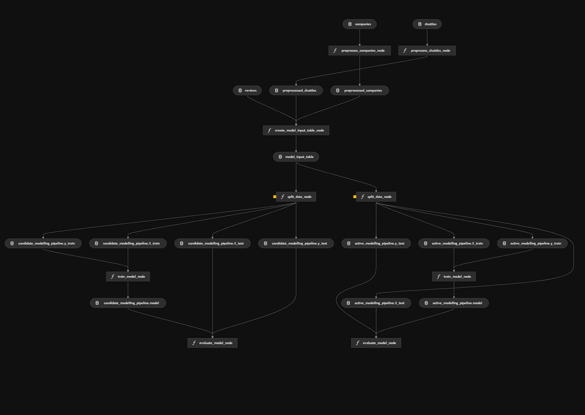

# Spaceflights

[](https://kedro.org)



## Overview

Spaceflights is a machine learning project that predicts spaceflight prices based on data from companies, customer reviews, and shuttles.
It uses [Kedro](https://kedro.org) to organize data processing, feature preparation, model training, and evaluation into reproducible pipelines.

The goal is to prepare the raw datasets, combine them into a single model input table, and evaluate a linear regression model using the R² score.

## Pipeline Architecture

The Kedro pipeline is organized into the following stages:

1. **Data cleaning**: The company and shuttle datasets are cleaned and transformed from `data/01_raw/` and saved to `data/02_intermediate/`.
2. **Reviews preprocessing**: The reviews dataset is cleaned and prepared for integration with the other datasets.
3. **Data integration**: The cleaned company, shuttle, and reviews datasets are merged into a single `model_input_table`, stored in `data/03_primary/`.
4. **Model training**: The prepared dataset is used to train a linear regression model, and stored in `data/06_models/`
5. **Model evaluation**: The model's performance is evaluated using the R² score.

## Project Structure

```
spaceflights/
├── conf/
│   ├── base/                  # Shared configuration (catalog, parameters)
│   └── local/                 # Local settings and credentials (not committed)
├── data/
│   ├── 01_raw/                # Original, immutable data (companies, reviews, shuttles)
│   ├── 02_intermediate/       # Cleaned and typed data
│   ├── 03_primary/            # Merged model_input_table
│   ├── 04_feature/            # Engineered features
│   ├── 05_model_input/        # Train/test splits
│   ├── 06_models/             # Trained models
│   ├── 07_model_output/       # Model predictions
│   └── 08_reporting/          # Reports and visualizations
├── docs/                      # Project documentation
├── notebooks/                 # Jupyter notebooks
├── src/
│   └── spaceflights/
│       ├── pipelines/
│       │   ├── data_processing/   # Cleaning and merging nodes
│       │   └── data_science/      # Training and evaluation nodes
│       ├── pipeline_registry.py
│       ├── settings.py
│       └── __main__.py
├── tests/                     # Unit and pipeline tests
├── kedro-pipeline.png
├── pyproject.toml
├── requirements.txt
└── README.md
```

## Installation

Declare any dependencies in `requirements.txt`, then install them with:

```bash
pip install -r requirements.txt
```

## Running the Pipeline

Run the full Kedro project with:

```bash
kedro run
```

Run the two separate Kedro pipelines with:
```bash
kedro run --pipeline data_processing
kedro run --pipeline data_science
```


## Working with Notebooks

When you use `kedro jupyter` or `kedro ipython`, the following variables are available in scope: `context`, `session`, `catalog`, and `pipelines`.

Jupyter, JupyterLab, and IPython are already included in the project requirements, so after running `pip install -r requirements.txt` no extra setup is needed.

### Jupyter

If you need to install Jupyter separately:

```bash
pip install jupyter
```

Then start a local notebook server:

```bash
kedro jupyter notebook
```